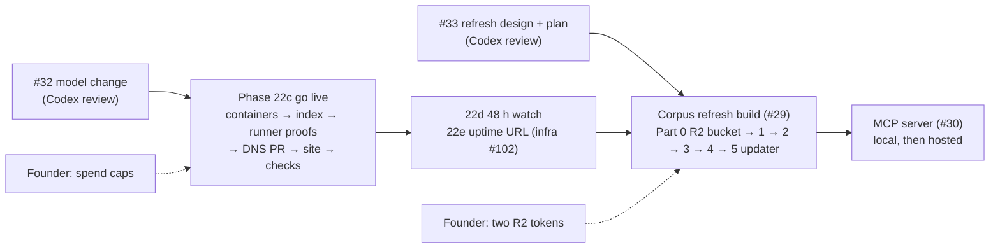

# FastPilot status

The current state, the planned work and the open to-dos. Keep this file current: any pull request that changes what is done, open or next updates it. The history lives in [`wiki/log.md`](../../wiki/log.md).

**Updated:** 24 Nov 2026

## Where we are

- **Nothing is public yet.** The production stack is built and checked (Phase 22a, 22b), and the next step is going live (Phase 22c). Staging is retired.
- **Model:** `gemini-3.8-flash` with `gemini-3.5-flash-lite` as fallback, chosen on 24 Nov from the evaluation results (#32).
- **Corpus:** the May 2026 corpus. It is only on the founder's Mac until the refresh moves it into a private R2 bucket. The index snapshot (4,241 chunks, SHA-256 `762a6402…`) is in `~/source/code/portfolio/fastpilot-index-snapshots/`.

## Planned work

| # | Work | State | Who merges |
|---|---|---|---|
| 1 | #32 production model | waiting for Codex | agent, when clean |
| 2 | #33 corpus refresh design, plan and this file | waiting for Codex | agent, when clean (documentation only) |
| 3 | Phase 22c go live (infra plan) | next; each server step asked first | founder (infra) |
| 4 | Phase 22d watch, 22e uptime (infra #102) | after 22c | founder (infra) |
| 5 | Corpus refresh build (#29), six PRs: [plan](../superpowers/plans/2026-11-24-corpus-refresh.md), [diagrams](https://claude.ai/artifact/Wjm2iHjE9zDAYvH1taet5R) | after go-live; subagent-driven | founder for Part 0, 3, 5 and new packages |
| 6 | MCP server (#30) | after the refresh; design first | — |
| 7 | Model follow-ups (#31): cost per call, router fallback | backlog | agent |

## Founder to-dos

- [ ] Spend caps: Gemini (`fastpilot-prod`: a budget alert and a daily request quota) and Voyage (usage limit). Needed before go-live.
- [ ] Opik: read the `fastpilot` project's trace retention and tell the agent, to record it.
- [ ] Delete the old Qdrant Cloud cluster in its dashboard, and the `QDRANT_URL` line in FastPilot's `.env`.
- [ ] Before the refresh build: create the two R2 tokens for `fastpilot-corpus` (read-write for the workflow, read-only for the server; Part 0 of the plan).
- [ ] When the refresh PRs ask: approve the new packages (`beautifulsoup4`, `markdownify`, `lxml`, an S3 client).

## Blockers

None. Go-live waits only for the two open PRs and the spend caps.

## Open issues worth knowing

#23 (compose ports; handled by the production file), #29 (refresh), #30 (MCP), #31 (model follow-ups), infra #102 (uptime).
