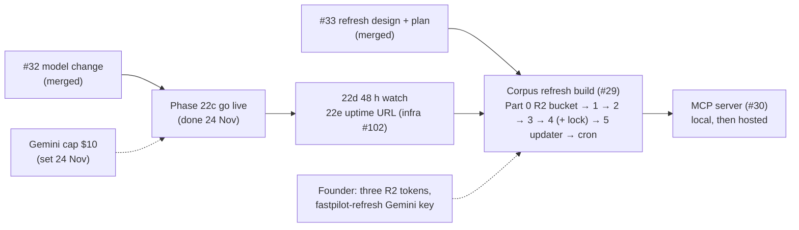

# FastPilot status

The current state, the planned work and the open to-dos. Keep this file current: any pull request that changes what is done, open or next updates it. The history lives in [`wiki/log.md`](../../wiki/log.md).

**Updated:** 28 Nov 2026, 14:00 UTC (the five image-publishing bumps merged; images publish cleanly as `sha-3bd7461`; production still on `sha-e97ff28`)

## Start of the next session

1. **Showcase video (#20):** the founder records a 20-second voice sample (`docs/demo-video.md`, step 1); then render the narration and record the real take (after midnight UTC, when the Agent limit has reset). Then part B in personal-website ([plan](../superpowers/plans/2026-11-26-showcase-video-remotion.md)), starting with the Remotion approval PR (founder merge).
2. #52 (Qdrant image): the local snapshot check, then a founder merge and a deploy at a quiet time.
3. Infra 22e step 5 (App Registry and docs). The 22d record (infra#128) merged.
4. Then Part 0 of the corpus refresh (#29), which needs your three R2 tokens.

## Open pull requests

All Dependabot. None is a security fix, and none reaches production until a deploy (`wiki/dependency-updates.md`). Each branch must be brought up to date with `main` before it merges (the repository's ruleset). Use an update merge, `gh pr update-branch <n>` without `--rebase`: a rebase rewrites the branch, which is a force-push (your choice, 28 Nov: "Update merge (Recommended)"). The update makes a new head commit, so ask `@codex review` again before merging (agent-workflows#66 asks whether that is needed).

- **Founder merge:** #52 qdrant/qdrant v1.18.0→v1.18.3 (`deploy/`): the local check against a restored snapshot, then a deploy at a quiet time. `qdrant-client` stays on 1.18.
- **New kind, from #77:** one grouped weekly PR moves the `python:3.12-slim` digest in the backend, frontend and runner Dockerfiles together. Merge on green checks. Check that the first one really is a single PR (Dependabot run logs).

Merged on 28 Nov: #53, #54, #55, #56, #80 (image-publishing actions; each publish on `main` passed, and the GHCR login worked on v4).

Merged on 26 Nov: #51, #57, #58, #59, #60 (Dependabot); #73, #74, #75, #77, #78, #81, #82, #83, #84.

Infra: none.

## Where we are

- **Security alerts (25 Nov):** Dependabot alerts are now on (they were off). They found 138 open alerts (8 critical, 83 high, 44 moderate, 3 low) in indirect packages in `uv.lock`, each shipping in the backend image, the frontend image or both. #47 (merged) clears all 138 by upgrading the lock; an OSV scan of the new lock finds none. Your choices: "Do everything in one go", including Pillow 13, which needs Streamlit 1.67 and fastembed 0.9.1; and "Upgrade, approve boto3 (Recommended)" for litellm 1.111, which puts `boto3` in the backend image. Deployed 26 Nov, 22:42 UTC, after the 48-hour watch, and the public checks passed. Weekly update PRs start when the config merges (your choice: "Yes, after the alert fix (Recommended)"). Each `uv` PR needs `scripts/export_constraints.sh` run on its branch before CI passes (`wiki/dependency-updates.md`).
- **Live since 24 Nov 2026, 21:22 UTC** at [fastpilot.olaheavy.dev](https://fastpilot.olaheavy.dev), with Chat, Agent and Playground on. **Now on `sha-e97ff28`** (deployed 26 Nov, 22:42 UTC; carries #47, #49, #63, #66, #73, #75, #77, #78). The 48-hour watch (22d) ended healthy: no errors, no OOM, memory peaks under caps, runner restarts only by its 6-hour rule; your choice: Agent and Playground stay on ("Keep them on (Recommended)"). After the deploy: `/health` healthy, `Qdrant/bm25` loaded, Opik pings once a minute per client, and a browser check in both themes found no request to any other site. Details: infra#128.
- **Themes fixed and deployed (24 Nov, about 23:55 UTC):** the app follows the visitor's system theme (the toggle is removed; your choice: "Follow the system only (Recommended)"), with code, link and border colours set for both themes and a readable Playground editor in dark mode (#40). Production runs `sha-7517b7a`; live checks in both themes passed. You chose "Stay on Streamlit (Recommended)": no React rewrite.
- **Privacy (25 Nov):** Streamlit usage statistics off (#63); Haystack, Opik's own Sentry crash reports and Hugging Face telemetry forced off (#66); decisions in `docs/production-decisions.md`. Google Fonts and jsDelivr removed by #73 (fonts and Monaco 0.36.1 served from our own site; upgrade weighed in #69, no known vulnerabilities). Opik's connection pings every 60 s, not every 6 s (#78; your choice: "Every 60 seconds (Recommended)").
- **Build hygiene (26 Nov):** base images pinned by digest with grouped Dependabot updates (#77; your choice: "Pin all three + Dependabot (Recommended)"); frontend `.dockerignore` (#75); README and wiki links to `olaheavy-dev/fastpilot` (#74).
- **Showcase video (26 Nov):** one route for #20 and personal-website#135 (#81; your choices: "Remotion for everything", Remotion in personal-website, "Cloned voice, labelled"). Part A built (#82): `tools/demo/` narration, live-site recorder and manifest; script approved with four ports from the Loom demo and Foresight (#83, #84).
- **Model:** `gemini-3.8-flash` with `gemini-3.5-flash-lite` as fallback (#32), running in production.
- **Corpus:** the May 2026 corpus. It is only on the founder's Mac until the refresh moves it into a private R2 bucket. The index snapshot (4,241 chunks, SHA-256 `762a6402…`) is in `~/source/code/portfolio/fastpilot-index-snapshots/`.

## Planned work

| # | Work | State | Who merges |
|---|---|---|---|
| 1 | #32 production model | merged 24 Nov | done |
| 2 | #33 corpus refresh design, plan and this file | merged 24 Nov after five Codex rounds; the three plan follow-ups (#34, #35, #36) folded into the plan and design on 25 Nov | done |
| 3 | Phase 22c go live (infra plan) | done 24 Nov: steps 1 to 7 passed; live at fastpilot.olaheavy.dev | done |
| 4 | Phase 22d watch, 22e uptime (infra #102) | 22d done 26 Nov (infra#128); 22e step 5 next | founder (infra) |
| 5 | Corpus refresh build (#29), seven PRs: [plan](../superpowers/plans/2026-11-24-corpus-refresh.md), [diagrams](https://claude.ai/artifact/Wjm2iHjE9zDAYvH1taet5R); plan reworked on 24 Nov after two fresh reviews | after go-live; subagent-driven | founder for Parts 0, 1, 2, 3, 5 and the bootstrap lock; agent for Part 4 |
| 6 | MCP server (#30), with the "About & connect" page in the app, `docs/mcp.md`, and the search-engine work (README, repository topics, a project page on the personal website, the MCP Registry listing) | after the refresh; design first | founder for the hosted part |
| 7 | Model follow-ups (#31): cost per call, router fallback | backlog | agent |
| 8 | Showcase video (#20, personal-website#135, #161): one route, [design](../superpowers/specs/2026-11-26-showcase-video-design.md), [diagram](https://claude.ai/artifact/KyL1sNL3rB2qdM96xTNd8F). FastPilot: walkthrough, script, narration; personal-website: Remotion scenes and edit | design and two plans written 26 Nov ([part A](../superpowers/plans/2026-11-26-showcase-video-capture.md), [part B](../superpowers/plans/2026-11-26-showcase-video-remotion.md)); part A's tools built (`tools/demo/`, how-to `docs/demo-video.md`); script approved by the founder 26 Nov, then four ports added and approved; the real take needs the founder's 20 s voice sample | founder for the Remotion PR in personal-website and the shot list; agent for the FastPilot capture |

## Founder to-dos

- [x] The 48-hour check and decision (26 Nov: Agent and Playground stay on).
- [ ] Read the Gemini usage page (against its $10 cap) and Voyage's (against the $7.50 alert): not read in the 48-hour check.
- [ ] Record a 20-second voice sample for the demo (`docs/demo-video.md`, step 1). Never commit it.
- [ ] Merge the Remotion approval PR in personal-website when part B starts (decision 0012).
- [ ] Keep the Mac awake during long agent work (`caffeinate -dimsu`): a sleep stopped a reviewer on 26 Nov.
- [x] Gemini: AI Studio monthly spend cap on `fastpilot-prod` set to $10 (24 Nov; stops requests when reached; no daily quota, your choice: "No, monthly is enough (Recommended)").
- [x] Voyage: no cap exists (your choice, 24 Nov: "Accept no cap, watch the bill"); the dashboard's monthly budget alert is set to $7.50 (24 Nov).
- [x] Merge infra #114 (merged 25 Nov, with #115).
- [ ] Recheck the Sources title on the live site in Chrome (reload with ⌘⇧R), with the Mac in Dark and then Light.
- [ ] Voyage: check the monthly bill, charged around the 2nd; first check 2 Dec 2026.
- [ ] Opik: read the `fastpilot` project's trace retention and tell the agent, to record it.
- [ ] Delete the old Qdrant Cloud cluster in its dashboard, and the `QDRANT_URL` line in FastPilot's `.env`.
- [ ] Before the refresh build: create the three R2 tokens for `fastpilot-corpus` (read-write for the workflow's publish and rollback, read-only for its other steps, read-only for the server; Part 0 of the plan), and note each one's expiry.
- [ ] Before Part 3: create a separate Gemini project `fastpilot-refresh` with its own key and its own AI Studio monthly spend cap (your choice, 24 Nov: "Separate project and key"), and the GitHub Environment `corpus-refresh` limited to `main`.
- [ ] When the refresh PRs ask: approve the new packages (`beautifulsoup4`, `markdownify`, `lxml`; on the server an S3 client and `jq`). `boto3` is already approved (25 Nov, with litellm).

## Decisions waiting for the founder

- **How the server's corpus status becomes public for the daily GitHub check** (needed by Part 5). The 24 Nov choice "Tag in /health + GitHub check" assumed the backend's `/health` is public; it isn't (only the frontend goes through Caddy), so that option text was wrong. Options: (a) Caddy serves the updater's `status.json` at `/corpus-status.json` (tag, point count, result, time; a Caddy change, founder merge) (recommended); (b) a Healthchecks.io ping (a new outside service); (c) expose one backend path through Caddy (widens what is public). The plan writes (a) as a proposal.

## Blockers

None.

## Open issues worth knowing

#23 (compose ports; handled by the production file), #29 (refresh), #30 (MCP), #31 (model follow-ups), #20 (showcase video), #69 (Monaco 0.36.1 and the unmaintained streamlit-monaco; no known vulnerabilities), #71 (frontend image runs as root), #76 (backend image has no `.dockerignore`), #79 (two Opik clients), infra #118 (registry links use the old repository name), infra #122 (infra CI action pins, sops in CI), infra #111 (the index-restore helper fails on a brief `yellow` status).
