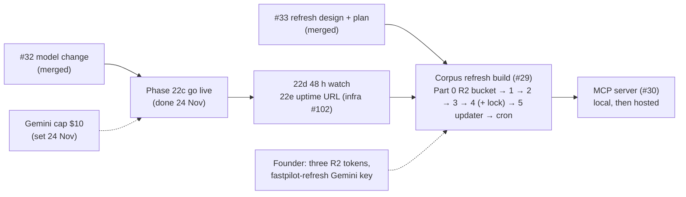

# FastPilot status

The current state, the planned work and the open to-dos. Keep this file current: any pull request that changes what is done, open or next updates it. The history lives in [`wiki/log.md`](../../wiki/log.md).

**Updated:** 26 Nov 2026, afternoon (#65 in review; uptime closed)

## Start of the next session

1. **48-hour check (22d), about 21:20 UTC on 26 Nov** (WireGuard on, from the Mac): memory peaks against caps, restarts, runner and backend logs, Caddy errors, spend. The 24-hour check (25 Nov, 23:08 UTC) was healthy: all containers healthy, no OOM, the runner's only restarts are its 6-hourly rule, very light traffic, spend far below the caps; Qdrant's page cache sits at its 256 MB cap (never killed). Then **the founder decides whether Agent and Playground stay on**.
2. **Deploy after the check:** `sha-` of `main` (#47 dependency alerts, #49 UI fixes, #63 Streamlit usage statistics off, #66 backend telemetry off) with `deploy-fastpilot.sh --stage containers`. Then check that the first backend boot loads `Qdrant/bm25` from Hugging Face (fastembed 0.9 has no other source), the public checks in both themes, and that the frontend log no longer says "Collecting usage statistics".
3. **Uptime check: done.** `uptime.yml` ran on its schedule at 05:09 UTC on 26 Nov under your account and passed, so infra #102 is closed. GitHub still runs the 15-minute schedule rarely (one run in about 22 hours). Your choice, 26 Nov: **"Close #102, GitHub is enough"**: no outside monitor for now.
4. **#65: self-host the fonts and the Monaco editor: in review as PR #73** ([design](../superpowers/specs/2026-11-26-self-host-fonts-monaco-design.md), [plan](../superpowers/plans/2026-11-26-self-host-fonts-monaco.md)). Your choices, 26 Nov: "Download at build, checked (Recommended)" and "Keep 0.36.1, open follow-up (Recommended)" (Monaco upgrade: #69). It deploys with the next deploy, after merge.
5. The Dependabot PRs (see Open pull requests).
6. Then Part 0 of the corpus refresh (#29), which needs your three R2 tokens.

## Open pull requests

Dependabot's first batch (opened 25 Nov, after #48). None is a security fix and none reaches production until a deploy. Work through them after the 48-hour check and the deploy, small ones first (`wiki/dependency-updates.md`):

- **Small updates, merge on green after the constraints step:** #60 fakeredis 2.36→2.40, #58 pytest-asyncio 1.4→1.5, #57 playwright 1.60→1.65 (test tools only). Run `scripts/export_constraints.sh` on each branch first, one PR at a time.
- **Major bumps, review first:** #59 ruff 0.15→0.17 (a `0.x` minor counts as major), #51 actions/setup-python 6→7, #53 actions/checkout 5→7, #54 docker/setup-buildx-action 3→4, #55 docker/login-action 3→4, #56 docker/metadata-action 5→6. #54–#56 change the image-publishing workflow: merge them after tomorrow's deploy, not before.
- **Image PR, review first (your rule):** #52 qdrant/qdrant v1.18.0→v1.18.3: the local check against a restored snapshot, then a deploy at a quiet time. `qdrant-client` stays on 1.18.

- **Base-image PRs (new, from #77):** one grouped weekly PR moves the `python:3.12-slim` digest in the backend, frontend and runner Dockerfiles together. Merge on green checks; it deploys with the next deploy. Check the first one really is a single PR (Dependabot run logs).

Infra: none.

## Where we are

- **Security alerts (25 Nov):** Dependabot alerts are now on (they were off). They found 138 open alerts (8 critical, 83 high, 44 moderate, 3 low) in indirect packages in `uv.lock`, each shipping in the backend image, the frontend image or both. #47 (merged) clears all 138 by upgrading the lock; an OSV scan of the new lock finds none. Your choices: "Do everything in one go", including Pillow 13, which needs Streamlit 1.67 and fastembed 0.9.1; and "Upgrade, approve boto3 (Recommended)" for litellm 1.111, which puts `boto3` in the backend image. Deploy it **after** the 48-hour watch ends (26 Nov, about 21:20 UTC), then re-run the public checks. Weekly update PRs start when the config merges (your choice: "Yes, after the alert fix (Recommended)"). Each `uv` PR needs `scripts/export_constraints.sh` run on its branch before CI passes (`wiki/dependency-updates.md`).
- **Live since 24 Nov 2026, 21:22 UTC** at [fastpilot.olaheavy.dev](https://fastpilot.olaheavy.dev), with Chat, Agent and Playground on (Phase 22c, infra #112 and the infra log). Now on image `sha-7517b7a` (theme fix, deployed the same night). All runner proofs and public checks passed. The 48-hour watch (22d) runs until 26 Nov. Merged since, waiting to deploy: #47, #49, #63, #66.
- **Themes fixed and deployed (24 Nov, about 23:55 UTC):** the app follows the visitor's system theme (the toggle is removed; your choice: "Follow the system only (Recommended)"), with code, link and border colours set for both themes and a readable Playground editor in dark mode (#40). Production runs `sha-7517b7a`; live checks in both themes passed. You chose "Stay on Streamlit (Recommended)": no React rewrite.
- **Privacy (25 Nov):** Streamlit usage statistics off (#63); Haystack, Opik's own Sentry crash reports and Hugging Face telemetry forced off (#66); decisions in `docs/production-decisions.md`. Google Fonts and jsDelivr: removed by #65 (PR #73, in review).
- **Model:** `gemini-3.8-flash` with `gemini-3.5-flash-lite` as fallback (#32), running in production.
- **Corpus:** the May 2026 corpus. It is only on the founder's Mac until the refresh moves it into a private R2 bucket. The index snapshot (4,241 chunks, SHA-256 `762a6402…`) is in `~/source/code/portfolio/fastpilot-index-snapshots/`.

## Planned work

| # | Work | State | Who merges |
|---|---|---|---|
| 1 | #32 production model | merged 24 Nov | done |
| 2 | #33 corpus refresh design, plan and this file | merged 24 Nov after five Codex rounds; the three plan follow-ups (#34, #35, #36) folded into the plan and design on 25 Nov | done |
| 3 | Phase 22c go live (infra plan) | done 24 Nov: steps 1 to 7 passed; live at fastpilot.olaheavy.dev | done |
| 4 | Phase 22d watch, 22e uptime (infra #102) | 22d now: summaries about 21:20 UTC on 25 and 26 Nov; then 22e | founder (infra) |
| 5 | Corpus refresh build (#29), seven PRs: [plan](../superpowers/plans/2026-11-24-corpus-refresh.md), [diagrams](https://claude.ai/artifact/Wjm2iHjE9zDAYvH1taet5R); plan reworked on 24 Nov after two fresh reviews | after go-live; subagent-driven | founder for Parts 0, 1, 2, 3, 5 and the bootstrap lock; agent for Part 4 |
| 6 | MCP server (#30), with the "About & connect" page in the app, `docs/mcp.md`, and the search-engine work (README, repository topics, a project page on the personal website, the MCP Registry listing) | after the refresh; design first | founder for the hosted part |
| 7 | Model follow-ups (#31): cost per call, router fallback | backlog | agent |

## Founder to-dos

- [x] Gemini: AI Studio monthly spend cap on `fastpilot-prod` set to $10 (24 Nov; stops requests when reached; no daily quota, your choice: "No, monthly is enough (Recommended)").
- [x] Voyage: no cap exists (your choice, 24 Nov: "Accept no cap, watch the bill"); the dashboard's monthly budget alert is set to $7.50 (24 Nov).
- [x] Merge infra #114 (merged 25 Nov, with #115).
- [ ] Recheck the Sources title on the live site in Chrome (reload with ⌘⇧R), with the Mac in Dark and then Light.
- [ ] Voyage: check the monthly bill, charged around the 2nd; first check 2 Dec 2026.
- [ ] Opik: read the `fastpilot` project's trace retention and tell the agent, to record it.
- [ ] Delete the old Qdrant Cloud cluster in its dashboard, and the `QDRANT_URL` line in FastPilot's `.env`.
- [ ] Before the refresh build: create the three R2 tokens for `fastpilot-corpus` (read-write for the workflow's publish and rollback, read-only for its other steps, read-only for the server; Part 0 of the plan), and note each one's expiry.
- [ ] Before Part 3: create a separate Gemini project `fastpilot-refresh` with its own key and its own AI Studio monthly spend cap (your choice, 24 Nov: "Separate project and key"), and the GitHub Environment `corpus-refresh` limited to `main`.
- [ ] When the refresh PRs ask: approve the new packages (`beautifulsoup4`, `markdownify`, `lxml`; on the server an S3 client and `jq`). `boto3` is already approved (25 Nov, with litellm).

## Decisions waiting for the founder

- **How the server's corpus status becomes public for the daily GitHub check** (needed by Part 5). The 24 Nov choice "Tag in /health + GitHub check" assumed the backend's `/health` is public; it isn't (only the frontend goes through Caddy), so that option text was wrong. Options: (a) Caddy serves the updater's `status.json` at `/corpus-status.json` (tag, point count, result, time; a Caddy change, founder merge) (recommended); (b) a Healthchecks.io ping (a new outside service); (c) expose one backend path through Caddy (widens what is public). The plan writes (a) as a proposal.

## Blockers

None.

## Open issues worth knowing

#23 (compose ports; handled by the production file), #29 (refresh), #30 (MCP), #31 (model follow-ups), #69 (Monaco 0.36.1 and the unmaintained streamlit-monaco), infra #118 (registry links use the old repository name), infra #122 (infra CI action pins, sops in CI), infra #111 (the index-restore helper fails on a brief `yellow` status).
