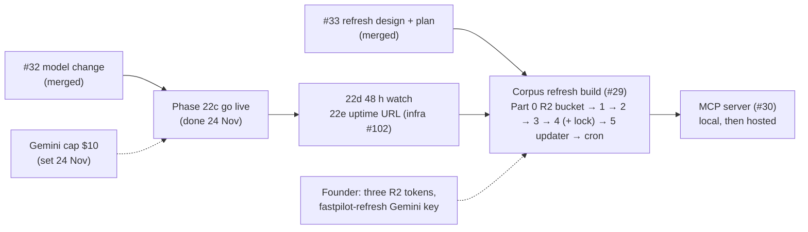

# FastPilot status

The current state, the planned work and the open to-dos. Keep this file current: any pull request that changes what is done, open or next updates it. The history lives in [`wiki/log.md`](../../wiki/log.md).

**Updated:** 25 Nov 2026, 00:10 UTC (end of session)

## Start of the next session

1. **22d, 24-hour watch, about 21:20 UTC on 25 Nov** (WireGuard on, from the Mac): memory peaks against caps, restarts, backend and runner logs, rate-limit refusals, Gemini usage against the $10 cap and Voyage against the $7.50 alert. Post a short summary. The 48-hour check is at the same time on 26 Nov; then the founder decides whether Agent and Playground stay on.
2. **Infra #114** (go-live records, architecture pages, the `sha-7517b7a` deploy log): Codex clean, no open threads; the founder merges it.
3. Then **22e** (uptime check to the new site, infra #102; App Registry), then the refresh plan follow-ups **#34, #35, #36** (documentation only), then Part 0 of the refresh (#29).

## Open pull requests

- **infra #114**: Phase 22c records and architecture pages. Waiting for the founder's merge.

## Where we are

- **Live since 24 Nov 2026, 21:22 UTC** at [fastpilot.olaheavy.dev](https://fastpilot.olaheavy.dev), with Chat, Agent and Playground on (Phase 22c, infra #112 and the infra log). Now on image `sha-7517b7a` (theme fix, deployed the same night). All runner proofs and public checks passed. The 48-hour watch (22d) runs until 26 Nov.
- **Themes fixed and deployed (24 Nov, about 23:55 UTC):** the app follows the visitor's system theme (the toggle is removed; your choice: "Follow the system only (Recommended)"), with code, link and border colours set for both themes and a readable Playground editor in dark mode (#40). Production runs `sha-7517b7a`; live checks in both themes passed. You chose "Stay on Streamlit (Recommended)": no React rewrite.
- **Model:** `gemini-3.8-flash` with `gemini-3.5-flash-lite` as fallback (#32), running in production.
- **Corpus:** the May 2026 corpus. It is only on the founder's Mac until the refresh moves it into a private R2 bucket. The index snapshot (4,241 chunks, SHA-256 `762a6402…`) is in `~/source/code/portfolio/fastpilot-index-snapshots/`.

## Planned work

| # | Work | State | Who merges |
|---|---|---|---|
| 1 | #32 production model | merged 24 Nov | done |
| 2 | #33 corpus refresh design, plan and this file | merged 24 Nov after five Codex rounds; three plan follow-ups open: #34 and #35 (before Part 2), #36 (before Part 5) | done |
| 3 | Phase 22c go live (infra plan) | done 24 Nov: steps 1 to 7 passed; live at fastpilot.olaheavy.dev | done |
| 4 | Phase 22d watch, 22e uptime (infra #102) | 22d now: summaries about 21:20 UTC on 25 and 26 Nov; then 22e | founder (infra) |
| 5 | Corpus refresh build (#29), seven PRs: [plan](../superpowers/plans/2026-11-24-corpus-refresh.md), [diagrams](https://claude.ai/artifact/Wjm2iHjE9zDAYvH1taet5R); plan reworked on 24 Nov after two fresh reviews | after go-live; subagent-driven | founder for Parts 0, 1, 2, 3, 5 and the bootstrap lock; agent for Part 4 |
| 6 | MCP server (#30), with the "About & connect" page in the app, `docs/mcp.md`, and the search-engine work (README, repository topics, a project page on the personal website, the MCP Registry listing) | after the refresh; design first | founder for the hosted part |
| 7 | Model follow-ups (#31): cost per call, router fallback | backlog | agent |

## Founder to-dos

- [x] Gemini: AI Studio monthly spend cap on `fastpilot-prod` set to $10 (24 Nov; stops requests when reached; no daily quota, your choice: "No, monthly is enough (Recommended)").
- [x] Voyage: no cap exists (your choice, 24 Nov: "Accept no cap, watch the bill"); the dashboard's monthly budget alert is set to $7.50 (24 Nov).
- [ ] Merge infra #114 (Codex clean).
- [ ] Recheck the Sources title on the live site in Chrome (reload with ⌘⇧R), with the Mac in Dark and then Light.
- [ ] Voyage: check the monthly bill, charged around the 2nd; first check 2 Dec 2026.
- [ ] Opik: read the `fastpilot` project's trace retention and tell the agent, to record it.
- [ ] Delete the old Qdrant Cloud cluster in its dashboard, and the `QDRANT_URL` line in FastPilot's `.env`.
- [ ] Before the refresh build: create the three R2 tokens for `fastpilot-corpus` (read-write for the workflow's publish and rollback, read-only for its other steps, read-only for the server; Part 0 of the plan), and note each one's expiry.
- [ ] Before Part 3: create a separate Gemini project `fastpilot-refresh` with its own key and its own AI Studio monthly spend cap (your choice, 24 Nov: "Separate project and key"), and the GitHub Environment `corpus-refresh` limited to `main`.
- [ ] When the refresh PRs ask: approve the new packages (`beautifulsoup4`, `markdownify`, `lxml`, an S3 client).

## Decisions waiting for the founder

- **How the server's corpus status becomes public for the daily GitHub check** (needed by Part 5). The 24 Nov choice "Tag in /health + GitHub check" assumed the backend's `/health` is public; it isn't (only the frontend goes through Caddy), so that option text was wrong. Options: (a) Caddy serves the updater's `status.json` at `/corpus-status.json` (tag, point count, result, time; a Caddy change, founder merge) (recommended); (b) a Healthchecks.io ping (a new outside service); (c) expose one backend path through Caddy (widens what is public). The plan writes (a) as a proposal.

## Blockers

None.

## Open issues worth knowing

#23 (compose ports; handled by the production file), #29 (refresh), #34 and #35 (refresh plan follow-ups from Codex round 4, fix before Part 2 (PR 2) is built), #36 (updater recovery when the live collection is missing, fix before Part 5 is built), #30 (MCP), #31 (model follow-ups), #38 (README badges and wiki link point to the old repository), infra #102 (uptime), infra #111 (the index-restore helper fails on a brief `yellow` status).
