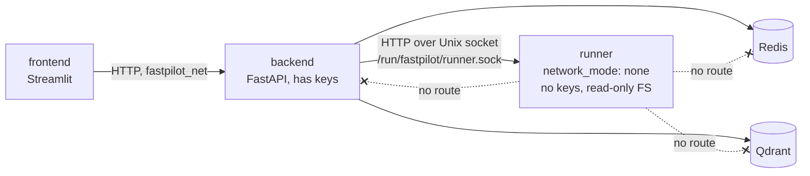

# Runner sidecar — design

Date: 22 November 2026 · Status: draft, awaiting founder approval · Builds on PR #17 (sandbox hardening)

## Intent and why

FastPilot's Agent and Playground run Python that visitors can influence. Two security reviews (November 2026)
showed that the AST scan in `app/augmentations/code_executor.py` cannot be the security boundary. One confirmed
escape (a string built at run time and used as a type annotation, which FastAPI evaluates as code) cannot be
closed by any static scan. Today, escaped code runs inside the backend container, which holds every API key
(Gemini, Voyage, Opik, Qdrant, Redis) and can reach Redis, Qdrant and the internet.

The founder wants the Agent and Playground kept, because they are the core of the portfolio showcase
("Keep both, add container isolation"). The infra rules forbid giving an app the Docker socket, so per-run
containers are out ("Runner sidecar (Recommended)"). The founder chose a Unix socket with no network for the
runner ("Unix socket, runner has no network (Recommended)").

**Success:** with `AGENT_ENABLED` and `PLAYGROUND_ENABLED` on at `fastpilot.olaheavy.dev`, code that escapes the
scan finds itself in a container with no keys, no network of any kind, a read-only filesystem and tight
memory/process limits. The worst it can do is waste the runner's own CPU until the time limit, or affect
other runs inside the runner until the next restart.

## Goals

1. Move code execution out of the backend into a separate `runner` container.
2. The runner has **no network** (`network_mode: none`) and **no secrets** in its environment or filesystem.
3. The backend talks to the runner over **HTTP on a Unix socket** in a shared volume.
4. Keep the existing executor behaviour inside the runner: scan, `python -I` child, `nobody` user, rlimits,
   bounded timeout, output caps, the same `ExecutionResult` fields.
5. Fail closed: if the runner is down, code execution returns a clear error; it never falls back to running
   code inside the backend in production.
6. Local `docker compose up` runs the three services the same way production will.

## Non-goals

- A brand-new container per run (needs the Docker socket; rejected).
- Changing the scan rules, the agent prompts or the frontend.
- The VPS deployment itself (self-hosted Qdrant/Redis, Caddy, Cloudflare, Watchtower). That is the separate
  infra phase after infra PR #85. This PR only makes the images and compose file ready for it.
- Fixing the rate limit (issue #12). It must land before a public relaunch, but in its own PR.

## Anti-goals (would make this a failure even if it works)

- The runner can open any network connection, including to the backend, Redis or Qdrant.
- Any API key or `.env` file is visible inside the runner.
- The backend silently runs code itself when the runner is unavailable.
- Normal agent tasks get noticeably slower (target: under 100 ms added per run).

## Constraints

- VPS: Hetzner cx23, 4 GB RAM, about 2.8 GB available today, shared with other apps. The runner gets a hard
  limit (`mem_limit: 512m`, `pids_limit: 128`).
- Infra rules (`~/source/code/infra`): no Docker socket for apps; `no-new-privileges`; images published to
  GHCR as `:main` and `sha-<commit>`; Watchtower updates by label and scope.
- The backend image runs as root today; the privilege drop to `nobody` inside the runner needs root plus the
  `SETUID`/`SETGID` capabilities.
- CI runs `ruff check .` then the hermetic `pytest` suite with a 90% coverage gate. New code must stay hermetic
  by default (no Docker needed for `uv run pytest`).

## Approaches considered

| Approach | Trade-off | Outcome |
|---|---|---|
| **Unix socket, runner has `network_mode: none`** | Strongest: no network stack at all, so escaped code cannot reach anything. The socket file could be replaced by escaped code, which is closed by directory permissions (below). | **Chosen by the founder.** |
| HTTP on an `internal: true` Docker network | Familiar and debuggable with curl, but the runner can then reach the backend's API on that network, so the backend needs an address-based guard. | Rejected: one more thing to get right. |
| Job queue in Redis | Decoupled, but the runner needs Redis, which holds chat memory and the semantic cache. | Rejected: escaped code could read other visitors' conversations. |
| Per-run containers via the Docker socket or a socket proxy | Strongest per-run isolation. | Rejected earlier: the infra security model allows the socket only for Watchtower. |

## The design



### Runner service (`runner/`)

- New top-level folder `runner/` with its own `Dockerfile`, `requirements.txt` and a tiny FastAPI app
  `runner/server.py`. Dependencies: only `fastapi`, `uvicorn`, `pydantic`, `httpx` (needed by
  `fastapi.testclient`). No Haystack, Redis, Qdrant, Voyage, Gemini or Opik packages, so the image is small and
  those clients do not even exist inside it.
- It reuses `app/augmentations/code_executor.py` unchanged. The runner image copies that one file (and its
  package `__init__`) so there is a single source of truth for the scan and limits. `code_executor.py` must
  not import anything from `app` at module level (it already only does so inside `get_executor()`).
- Endpoints, served by `uvicorn --uds /run/fastpilot/runner.sock`:
  - `POST /run` with `{"code": str}` → the `ExecutionResult` fields as JSON.
  - `GET /health` → `{"status": "ok", "runs": <count>, "uid": <euid>}`.
- Runs at most **2 jobs at once** (a semaphore); extra requests wait up to the backend's timeout. This keeps
  memory inside `mem_limit` under the concurrent-soak load.
- Self-restart for freshness: after **200 runs or 6 hours**, whichever comes first, the runner finishes its
  current jobs and exits with code 0; Docker's `restart: always` starts a clean container. (Builder's call on
  the exact numbers; these are my defaults.)

### Socket and permissions (closes the "fake runner" risk)

- A named volume `runner_sock` is mounted at `/run/fastpilot` in both containers.
- At start, the runner (root inside its container) sets `/run/fastpilot` to owner `root:root`, mode `0755`,
  creates the socket, and sets the socket to mode `0660` with group `fastpilot-sock` (a fixed gid, for example
  `1500`).
- Sandboxed child processes run as `nobody` (uid 65534), who cannot create, delete or rename files in a
  root-owned `0755` folder. So escaped code cannot replace the socket or impersonate the runner.
- The backend runs as root today, so it can connect. If the backend later moves to a non-root user, it joins
  group `1500`.

### Runner container hardening (compose)

```yaml
runner:
  image: ghcr.io/<owner>/fastpilot-runner:main
  network_mode: none
  read_only: true
  tmpfs:
    - /tmp:size=64m,mode=1777
  volumes:
    - runner_sock:/run/fastpilot
  cap_drop: [ALL]
  cap_add: [SETUID, SETGID, CHOWN, KILL]   # drop to nobody, chown the run dir, kill the run's process group
  security_opt: [no-new-privileges:true]
  mem_limit: 512m
  pids_limit: 128
  environment: {}                          # nothing; never `env_file: .env`
  restart: always
```

- `KILL` is needed because, once the child runs as `nobody`, root needs `CAP_KILL` to signal it.
- The `/tmp` tmpfs is where per-run temp folders live; it is wiped when the container restarts.

### Backend changes

- New `app/augmentations/runner_client.py`: `RunnerClient` with the same interface as `SubprocessExecutor`:
  `run(code: str) -> ExecutionResult`. It uses `httpx.Client(transport=httpx.HTTPTransport(uds=path))`, a
  timeout of `executor_wall_timeout_s + 10` seconds, and maps the JSON back to `ExecutionResult`.
- New setting `executor_mode: Literal["local", "runner"]` (env `EXECUTOR_MODE`), default `"local"` so tests
  and plain local runs keep working, and `runner_socket: str = "/run/fastpilot/runner.sock"`.
- `get_executor()` returns `RunnerClient` when `executor_mode == "runner"`, else `SubprocessExecutor`.
- **Fail closed:** if the runner cannot be reached or times out, `RunnerClient.run` returns an
  `ExecutionResult` with `blocked=True` and reason `"code runner unavailable"`. It never runs code locally.
- **Safety gate at startup:** if `AGENT_ENABLED` or `PLAYGROUND_ENABLED` is true, `EXECUTOR_MODE` is `local` and
  the new setting `allow_local_executor` is false, the backend logs an error and forces both flags off.
  `allow_local_executor` defaults to true for development; production sets it to false. (This is the guard the
  reviewer asked for: production cannot accidentally run code in the backend.)
- `/health` reports `executor: "runner" | "local"` and, in runner mode, whether the runner's `/health`
  answers.

### Compose and images

- `docker-compose.yml`: add the `runner` service and the `runner_sock` volume; the backend gets
  `EXECUTOR_MODE=runner`, `ALLOW_LOCAL_EXECUTOR=false` and the volume mount.
- `.github/workflows/publish-ghcr.yml`: add a third matrix entry `runner` (context `.`, file
  `runner/Dockerfile`, because the image copies `app/augmentations/code_executor.py`).
- The infra repo's FastPilot compose template is updated in the separate infra phase, not here.

## Testing

- **Hermetic (default `uv run pytest`):**
  - `runner/server.py` with FastAPI's `TestClient` and a fake executor: request/response shape,
    concurrency semaphore, run counter and restart trigger.
  - `RunnerClient` against a real runner app served on a temp Unix socket in-process (uvicorn in a thread),
    plus fail-closed when the socket is missing or the server hangs.
  - Settings: the startup safety gate turns the flags off when it should.
- **Integration (`-m integration`, needs Docker):** `docker compose up runner backend`, then prove:
  - the three captured agent programs pass through `/execute`;
  - inside the runner, with the scan disabled through a test-only image build arg, `socket.create_connection`
    fails (no network), `env` shows no keys, writing outside `/tmp` fails (read-only), and `nobody` cannot
    delete or replace `/run/fastpilot/runner.sock`;
  - stopping the runner makes `/execute` return the "code runner unavailable" guard, not a 500.
- Coverage gate stays at 90% for `app`; `runner/` is added to coverage.

## Decided by the founder (22 Nov 2026)

- Keep Agent and Playground; add container isolation.
- Runner sidecar, not per-run containers.
- Unix socket, runner has no network.
- Two PRs: hardening (PR #17) first, runner next.

## My calls (founder can correct)

- HTTP over the Unix socket with a tiny FastAPI app, rather than a custom line protocol: reuses the stack and
  is easy to test.
- Runner limits: 2 concurrent jobs, `mem_limit 512m`, `pids_limit 128`, restart after 200 runs or 6 hours.
- Socket folder owned by root with mode `0755`, so `nobody` cannot replace the socket.
- `EXECUTOR_MODE=local` stays the default for development and tests; production must set `runner`, and the
  startup gate enforces it.
- The runner image builds from the repo root so it reuses `code_executor.py` instead of copying its logic.

## Left to the builder

- Exact file layout inside `runner/`, logging format, and how the restart counter is implemented.
- Whether the semaphore wait has its own timeout or relies on the client timeout.
- Dockerfile details (base image `python:3.12-slim` to match the backend).
