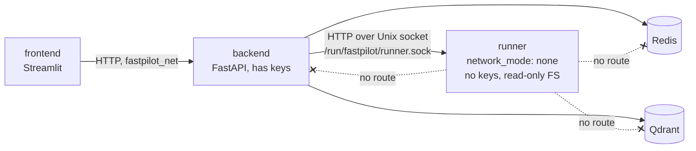

# Runner sidecar — design

Date: 22 November 2026 · Status: approved by the founder on 22 Nov 2026 ("Approve + visual page (Recommended)") · Builds on PR #17 (sandbox hardening)

Revised after a builder check (a fresh reviewer read it as if planning the build).

## Intent and why

FastPilot's Agent and Playground run Python that visitors can influence. Two security reviews (November 2026)
showed that the AST scan in `app/augmentations/code_executor.py` cannot be the security boundary. One confirmed
escape (a string built at run time and used as a type annotation, which FastAPI evaluates as code) cannot be
closed by any static scan. Today, escaped code runs inside the backend container, which holds every API key
(Gemini, Voyage, Opik, Qdrant, Redis) and can reach Redis, Qdrant and the internet.

The founder wants the Agent and Playground kept, because they are the core of the portfolio showcase
("Keep both, add container isolation"). The infra rules forbid giving an app the Docker socket, so per-run
containers are out ("Runner sidecar (Recommended)"). The founder chose a Unix socket with no network for the
runner ("Unix socket, runner has no network (Recommended)").

**Success:** with `AGENT_ENABLED` and `PLAYGROUND_ENABLED` on at `fastpilot.olaheavy.dev`, code that escapes the
scan finds itself in a container with no keys, no network of any kind, a read-only filesystem and tight
memory/process limits. Nothing it starts survives the end of its run, so it cannot see or change other
visitors' code or output. The worst it can do is waste the runner's CPU and memory until its own limits stop it.

## Goals

1. Move code execution out of the backend into a separate `runner` container.
2. The runner has **no network** (`network_mode: none`) and **no secrets** in its environment or filesystem.
3. The backend talks to the runner over **HTTP on a Unix socket** in a shared volume.
4. Keep the existing executor behaviour inside the runner: scan, `python -I` child, unprivileged user,
   rlimits, bounded timeout, output caps, the same `ExecutionResult` fields (including `unavailable`, added in
   PR #17).
5. **Isolate visitors from each other:** each concurrent slot has its own uid, and after every run all of that
   uid's processes are killed and its folder deleted.
6. Fail closed: if the runner is down, code execution returns a clear error; it never falls back to running
   code inside the backend in production.
7. Local `docker compose up` runs the three services the same way production will.

## Non-goals

- A brand-new container per run (needs the Docker socket; rejected).
- Changing the scan rules, the agent prompts or the frontend.
- The VPS deployment itself (self-hosted Qdrant/Redis, Caddy, Cloudflare, Watchtower). That is the separate
  infra phase after infra PR #85. This PR only makes the images and compose file ready for it.
- Fixing the rate limit (issue #12). It must land before a public relaunch, but in its own PR.

## Anti-goals (would make this a failure even if it works)

- The runner can open any network connection, including to the backend, Redis or Qdrant.
- Any API key or `.env` file is visible inside the runner.
- The backend silently runs code itself when the runner is unavailable.
- Normal agent tasks get noticeably slower (target: under 100 ms added per run).

## Constraints

- VPS: Hetzner cx23, 4 GB RAM, about 2.8 GB available today, shared with other apps. Founder's choice:
  "256 MB per run, 2 at once, 768 MB cap (Recommended)", so `EXECUTOR_MEM_MB=256`, 2 slots, `mem_limit: 768m`
  (2 × 256 MB children plus about 100 MB for uvicorn, with headroom), `pids_limit: 128`. The 256 MB limit is
  per process (a run may start several processes, up to 48), so the 768 MB container cap is the real bound.
- Infra rules (`~/source/code/infra`): no Docker socket for apps; `no-new-privileges`; images published to
  GHCR as `:main` and `sha-<commit>`; Watchtower updates by label and scope.
- The backend image runs as root today; the privilege drop to `nobody` inside the runner needs root plus the
  `SETUID`/`SETGID` capabilities.
- CI runs `ruff check .` then the hermetic `pytest` suite with a 90% coverage gate. New code must stay hermetic
  by default (no Docker needed for `uv run pytest`).

## Approaches considered

| Approach | Trade-off | Outcome |
|---|---|---|
| **Unix socket, runner has `network_mode: none`** | Strongest: no network stack at all, so escaped code cannot reach anything. The socket file could be replaced by escaped code, which is closed by directory permissions (below). | **Chosen by the founder.** |
| HTTP on an `internal: true` Docker network | Familiar and debuggable with curl, but the runner can then reach the backend's API on that network, so the backend needs an address-based guard. | Rejected: one more thing to get right. |
| Job queue in Redis | Decoupled, but the runner needs Redis, which holds chat memory and the semantic cache. | Rejected: escaped code could read other visitors' conversations. |
| Per-run containers via the Docker socket or a socket proxy | Strongest per-run isolation. | Rejected earlier: the infra security model allows the socket only for Watchtower. |

## The design



### Runner service (`runner/`)

- New top-level folder `runner/` with its own `Dockerfile`, `requirements.txt` and a tiny FastAPI app
  `runner/server.py`. Dependencies: only `fastapi`, `uvicorn`, `pydantic`, `httpx` (needed by
  `fastapi.testclient`). No Haystack, Redis, Qdrant, Voyage, Gemini or Opik packages, so the image is small and
  those clients do not even exist inside it.
- It reuses `app/augmentations/code_executor.py`, so there is one source of truth for the scan and limits.
  The runner image copies `app/__init__.py`, `app/augmentations/__init__.py`, `code_executor.py` and
  `security.py` (the package `__init__` imports `security`; it needs only `re` and `typing`).
  `code_executor.py` must not import anything else from `app` at module level (today it only does so inside
  `get_executor()`).
- `code_executor.py` changes in two small ways (no change in behaviour for the backend's local mode):
  - `SubprocessExecutor` takes `sandbox_uid` / `sandbox_gid` (default 65534, as today).
  - Cleanup of the run folder is done by a second short `python -I` process running **as the run's uid**
    (`shutil.rmtree`), because root inside the runner has no `DAC_OVERRIDE`/`FOWNER` and cannot list a 0700
    folder it doesn't own. Errors are logged, never raised.
- Endpoints, served by `uvicorn --uds /run/fastpilot/runner.sock`:
  - `POST /run` with `{"code": str}` → the `ExecutionResult` fields as JSON.
  - `GET /health` → `{"status": "ok", "runs": <count>, "slots_free": <count>}`. (Changed during build: the first draft returned the runner's `uid`; `slots_free` is more useful to the backend's health check.)
- **Two slots**, each with its own uid/gid: slot 1 = 61001, slot 2 = 61002 (fixed numbers, not used by any
  other account in the image). A request takes a free slot or waits for one, up to `RUNNER_QUEUE_WAIT_S` (default 8 s, under the backend's
  timeout); after that it gets `[runner] busy` (`unavailable=True`), so a job the backend gave up on never runs
  later for nobody. (Changed in the final review: the first draft waited forever.)
- **After every run in a slot** (success, error or timeout): kill every process owned by that slot's uid
  (scan `/proc/*/status` for the uid, send `SIGKILL`; root has `CAP_KILL`), then delete the slot's folder as
  that uid. Founder's choice: "Kill leftovers after every run (Recommended)". This is what stops one
  visitor's escaped process from watching the next visitor's code.
- Self-restart for freshness: after **200 runs or 6 hours**, whichever comes first, the runner finishes its
  current jobs and exits with code 0; Docker's `restart: always` starts a clean container. (Builder's call on
  the exact numbers; these are my defaults.)

### Socket and permissions (closes the "fake runner" risk)

- A named volume `runner_sock` is mounted at `/run/fastpilot` in both containers.
- At start, the runner (root inside its container) sets `/run/fastpilot` to owner `root:root`, mode `0755`.
- The runner **creates and binds the socket itself**, sets it to mode `0660` owned by `root` with group 1500,
  and hands the bound socket to `uvicorn.Server` (`server.run(sockets=[sock])`). Using `uvicorn --uds` would
  not work: uvicorn sets a new socket to `0666` after binding, which would let escaped code connect and submit
  jobs.
- Sandboxed child processes run as the slot uids (61001/61002), which are not in group 1500 and cannot create,
  delete or rename files in a root-owned `0755` folder. So escaped code can neither connect to the runner nor
  replace its socket.
- The backend runs as root today, so it can connect. If the backend later moves to a non-root user, it joins
  group `1500`.

### Runner container hardening (compose)

```yaml
runner:
  image: ghcr.io/<owner>/fastpilot-runner:main
  network_mode: none
  read_only: true
  tmpfs:
    - /tmp:size=64m,mode=1777
    - /dev/shm:size=8m,mode=1777       # Docker mounts a writable /dev/shm even with read_only; keep it tiny
  volumes:
    - runner_sock:/run/fastpilot
  cap_drop: [ALL]
  cap_add: [SETUID, SETGID, CHOWN, KILL]   # drop to nobody, chown the run dir, kill the run's process group
  security_opt: [no-new-privileges:true]
  mem_limit: 768m
  pids_limit: 128
  environment:                             # limits only; never `env_file: .env`, never a key
    EXECUTOR_WALL_TIMEOUT_S: "15"
    EXECUTOR_CPU_SECONDS: "10"
    EXECUTOR_MEM_MB: "256"
    RUNNER_SLOTS: "2"
  restart: always
```

- `KILL` is needed because root needs `CAP_KILL` to signal processes owned by another uid. `CHOWN` hands the
  run folder to the slot uid and gives the socket its group. `SETUID`/`SETGID` let `Popen(user=, group=)`
  switch. No `DAC_OVERRIDE` or `FOWNER`: cleanup runs as the slot uid instead.
- The limit values are not secrets. The backend reads the same values from its own environment for the
  client timeout; compose sets both from one place (a YAML anchor), so they cannot drift.
- The `/tmp` tmpfs holds per-run folders; they are deleted after each run and the tmpfs is wiped on restart.

### Backend changes

- New `app/augmentations/runner_client.py`: `RunnerClient` with the same interface as `SubprocessExecutor`:
  `run(code: str) -> ExecutionResult`. It uses `httpx.Client(transport=httpx.HTTPTransport(uds=path))`, a
  timeout of `executor_wall_timeout_s + 15` seconds (changed from + 10 in the final review), and maps the JSON back to `ExecutionResult`.
- New setting `executor_mode: Literal["local", "runner"]` (env `EXECUTOR_MODE`), default `"local"` so tests
  and plain local runs keep working, and `runner_socket: str = "/run/fastpilot/runner.sock"`.
- `get_executor()` returns `RunnerClient` when `executor_mode == "runner"`, else `SubprocessExecutor`.
- `RunnerClient` allows at most `runner_max_in_flight` (default 3: the runner's 2 slots + 1) calls at once. A
  call over that limit gets `[sandbox] code runner busy` (`unavailable=True`) at once, so waiting Playground and
  Agent calls cannot fill the backend's thread pool, which Chat's RAG pipeline also uses.
- **Fail closed:** if the runner cannot be reached or times out, `RunnerClient.run` returns an
  `ExecutionResult` with `unavailable=True` (added in PR #17). `/execute` already maps that to the
  `unavailable` guard ("The code sandbox isn't available right now"), and the Agent stops instead of spending
  Gemini calls on fixes. It never runs code locally. No frontend change is needed: the Playground shows any
  guard's message.
- **Safety gate at startup:** if `AGENT_ENABLED` or `PLAYGROUND_ENABLED` is true, `EXECUTOR_MODE` is `local` and
  the new setting `allow_local_executor` is false, the backend logs an error and forces both flags off.
  `allow_local_executor` defaults to true for development; production sets it to false. (This is the guard the
  reviewer asked for: production cannot accidentally run code in the backend.)
- `/health` reports `executor: "runner" | "local"` and, in runner mode, whether the runner's `/health`
  answers.
- The frontend keeps reading `AGENT_ENABLED` / `PLAYGROUND_ENABLED` from its own environment; both services
  read them from the same env_file (changed after Codex review on PR #19: a compose `environment` default
  would override a kill switch set in that file). If the backend's safety gate turns them off while the frontend still
  shows the tabs, visitors see the existing "disabled" messages. Syncing the frontend from `/health` is a
  possible later improvement, not part of this PR.

### Compose and images

- `docker-compose.yml`: add the `runner` service and the `runner_sock` volume; the backend gets
  `EXECUTOR_MODE=runner`, `ALLOW_LOCAL_EXECUTOR=false` and the volume mount.
- `.github/workflows/publish-ghcr.yml`: add a third matrix entry `runner` (context `.`, file
  `runner/Dockerfile`, because the image copies `app/augmentations/code_executor.py`).
- The infra repo's FastPilot compose template is updated in the separate infra phase, not here.

## Testing

- **Hermetic (default `uv run pytest`):**
  - `runner/server.py` with FastAPI's `TestClient` and a fake executor: request/response shape, slot
    handling, the leftover-process killer (with a fake `/proc` reader), run counter and restart trigger.
  - `RunnerClient` against a real runner app served on a temp Unix socket in-process (uvicorn in a thread),
    plus fail-closed when the socket is missing or the server hangs.
  - Settings: the startup safety gate turns the flags off when it should.
- **Integration (`-m integration`, needs Docker):** `docker compose up runner backend`, then prove:
  - the three captured agent programs pass through `/execute`;
  - probes run with `docker exec --user 61001 runner python -c ...` (no "scan off" switch exists in any image):
    `socket.create_connection` fails (no network), `env` shows no keys, writing outside `/tmp` and
    `/dev/shm` fails (read-only), and the slot uid cannot connect to, delete or replace
    `/run/fastpilot/runner.sock`;
  - a process left behind in a slot (started with `docker exec --user 61001 ... setsid sleep 600`) is gone
    after the next run in that slot;
  - stopping the runner makes `/execute` return the "code runner unavailable" guard, not a 500.
- Coverage gate stays at 90% for `app`; `runner/` is added to coverage.

## Decided by the founder (22 Nov 2026)

- Keep Agent and Playground; add container isolation.
- Runner sidecar, not per-run containers.
- Unix socket, runner has no network.
- Two PRs: hardening (PR #17) first, runner next.
- "256 MB per run, 2 at once, 768 MB cap (Recommended)".
- "Kill leftovers after every run (Recommended)": a uid per slot, kill and clean after each run.

## My calls (founder can correct)

- HTTP over the Unix socket with a tiny FastAPI app, rather than a custom line protocol: reuses the stack and
  is easy to test.
- `pids_limit 128`, and a restart after 200 runs or 6 hours as an extra clean-up on top of the per-run kill.
- Socket folder owned by root with mode `0755`, and a socket bound by our own code at `0660`, so slot users
  can neither connect nor replace it.
- Cleanup as the slot uid instead of adding `DAC_OVERRIDE`/`FOWNER` to the runner.
- Non-secret limit settings in the runner's environment, set from one place in compose.
- No "scan off" switch in any image; integration probes use `docker exec --user`.
- `EXECUTOR_MODE=local` stays the default for development and tests; production must set `runner`, and the
  startup gate enforces it.
- The runner image builds from the repo root so it reuses `code_executor.py` instead of copying its logic.

## Left to the builder

- Exact file layout inside `runner/`, logging format, and how the restart counter is implemented.
- Whether the semaphore wait has its own timeout or relies on the client timeout. Resolved in the final review: its own timeout, `RUNNER_QUEUE_WAIT_S` (8 s).
- Dockerfile details (base image `python:3.12-slim` to match the backend).

## Rulings made during the build (22 Nov 2026)

Calls the build controller made on the founder's behalf, each with what it costs if wrong. The founder
can reverse any of them.

| Ruling | Decision | Cost if wrong |
|---|---|---|
| A | Tests that bind real Unix sockets use a short folder under `/tmp`, because macOS limits socket paths to about 104 bytes. | Flaky path errors on macOS only. |
| B | The runner app exposes `ready_to_exit()`; `main()` polls it and stops uvicorn. | A small refactor. |
| C | In runner mode `/health` adds `components.code_runner`, and the response gains `executor`. | `/health` shows degraded while only the runner is down (intended). |
| D | After every run: kill the slot's processes first, then delete every file that slot's user owns, as that user. | One extra short process per run (about 30 ms). |
| E | Once the restart rule fires, new runs answer "restarting" instead of queueing. | Visitors see "sandbox unavailable" for a few seconds during a restart. |
| F | A failed kill holds the slot back and restarts the runner (fail closed). | One unnecessary restart. |
| G | The clean-up covers `/dev/shm` as well as `/tmp`. | One more folder scan per run. |
| H | The runner container runs with `init: true` so orphaned processes are reaped. | None. |
| I | A clean-up that fails or times out counts as a failed kill (hold back, restart). | An extra restart. |
| J | `httpx` is declared as a direct dependency of the backend. | None. |
| K | The backend's client timeout is the wall timeout plus 15 s (the plan said plus 10). | A visitor waits 5 s longer when the runner hangs. |
| L | Each run may start at most 48 processes, which leaves headroom under the container's 128. | Code that needs more than 48 processes or threads fails (FastAPI examples use fewer than 10). |
| After review | A request waits at most 8 s for a slot, and the backend allows at most 3 runner calls at once (whole-branch review). | Busy periods show "sandbox busy" sooner. |
| After Codex | Compose no longer sets the Agent and Playground switches in `environment`, so a switch set in `.env` is never overridden (Codex review on PR #19). | None. |
