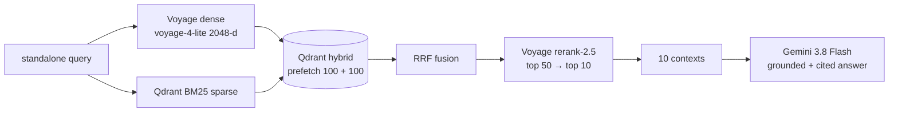
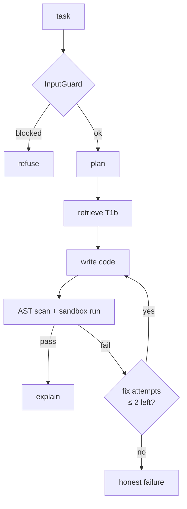
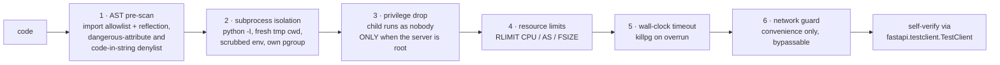
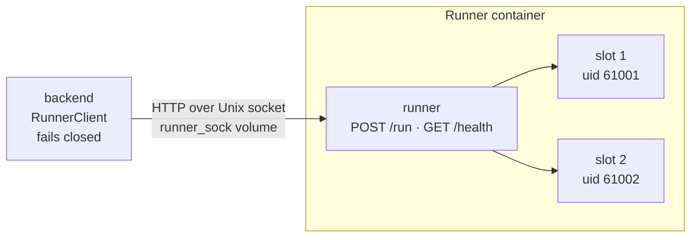

# Component Architecture

> The building blocks under `app/` and how they collaborate. Routes that call these live
> in [[endpoint-summary]]; the conventions they follow are in [[coding-conventions]].

The backend is organized into four layers under `app/`:

- **`services/`** — the RAG runtime (pipeline, cache, memory, router).
- **`components/`** — Haystack-compatible retrieval pieces (hybrid retriever, reranker).
- **`augmentations/`** — the augmentation layer (agent, sandbox executor, security, rate limit).
- **`prompts/`** — prompt templates + Opik registry (no logic, no heavy imports).

Plus cross-cutting modules: `config.py` (settings), `observability.py` (Opik shim),
`dogfood.py` (usage log), `formatting.py`, `redis_client.py`, `logging_config.py`, `models.py`.

> Every production service below is an explicit **add / skip decision** with a rationale —
> the full reasoning (and what was *skipped*) is in the
> [production-decisions essay](https://github.com/sunkanmi-olawuwo/fastpilot/blob/main/docs/production-decisions.md).

## Services (`app/services/`)

### RAG pipeline — `rag_pipeline.py`
The production **T1b** pipeline, split into `retrieve()` and `generate()` so the API can
overlap retrieval with classification and stream generation independently.

- Reuses the cache lookup's dense embedding so retrieval never re-embeds the same query.
- `generate_stream()` returns an `asyncio.Queue` of tokens for SSE; a background producer
  task is cancelled if the client disconnects.
- Falls back to `gemini-3.5-flash-lite` on the primary model's failure (`fallback_used`); the main model is `gemini-3.8-flash`.
- `is_healthy()` gates `/health` and the `/fix` endpoint.

> **Why this design (evidence, not a default).** T1b was picked by a 4-way pairwise bake-off:
> it won **30 / 36** comparisons, **reranking alone was worth +21 points**, and a two-stage
> LLM-routing variant (T3) — competitive on retrieval but **~34 s/query** — was measured and
> *skipped*. The index it retrieves over is built by a hybrid **AST (code) + markdown-recursive
> (prose)** chunker; migrating **BGE → Voyage-4-lite (2048-d)** removed **27.9% silent chunk
> truncation**. Full essays:
> [retrieval-strategy](https://github.com/sunkanmi-olawuwo/fastpilot/blob/main/docs/retrieval-strategy.md) ·
> [chunking-strategy](https://github.com/sunkanmi-olawuwo/fastpilot/blob/main/docs/chunking-strategy.md).

### Semantic cache — `semantic_cache.py`
Redis **HNSW vector search** for sub-50 ms answers to repeated/paraphrased queries. Returns
`(hit_or_None, embedding)` so the embedding computed for the lookup is reused downstream.
Tuned conservatively (`cache_distance_threshold = 0.16`) to favour **zero wrong-answer
serving** over hit-rate — the paraphrase/near-miss bands overlap (see [[feature-coverage]]
→ *Honest limitations*).

### Conversation memory — `conversation.py`
Redis **sliding window** (last 10 turns) keyed by session, plus **conditional query
rewriting**: a follow-up like *"can it be an integer?"* is rewritten to a standalone query
*"Can a query parameter with a default value be an integer?"* before retrieval. Refusals are
deliberately **not** stored, so the next genuine question isn't mis-treated as a follow-up.

### Query router — `query_router.py`
Classifies each query (`FACTUAL` / `HOW_TO` / `CODE_GENERATION` / …) and builds a
**type-specific prompt** from the retrieved contexts. Classification and retrieval run
concurrently because both depend only on the standalone query.

## Components (`app/components/`)

| Component | Role |
|---|---|
| `qdrant_hybrid_retriever.py` | Hybrid retrieval via Qdrant's native API with explicit dense/sparse prefetch limits, RRF fusion. |
| `voyage_reranker.py` | Haystack-compatible wrapper around Voyage `rerank-2.5`. |

## Augmentations (`app/augmentations/`)

### Agent orchestrator — `agent_orchestrator.py`
A **deterministic, code-driven loop** (not free-form tool calling), mirroring the
CRAG routing philosophy. Each step is yielded as an SSE event so the UI timeline updates live.

Framework-light and fully unit-testable: inject a fake `pipeline` + fake `executor`.

> **Measured impact (the augmentation's whole point).** First-attempt success runs ~50%; the
> **≤2-fix self-correction loop lifts it to 100%** (+50 pts) across the 10 golden tasks. **93%**
> of cited chunks mention the API used, and fix-from-traceback recovers **3 / 3** broken snippets.
> Full essay:
> [augmentation-decisions](https://github.com/sunkanmi-olawuwo/fastpilot/blob/main/docs/augmentation-decisions.md).

### Sandboxed code executor — `code_executor.py`
The one net-new piece with no off-the-shelf equivalent. Runs agent/user FastAPI code behind
**layered defenses**. These run inside the runner sidecar (see below), which is the boundary:

> **Honest boundary — changed 2026-11-22:** the AST scan is a **filter, not a security boundary**
> (the runner sidecar below is the boundary).
> The scan moved from an import denylist to an **allowlist** after a review found shell escapes
> (`posix.system`, `os.spawn*`, `__builtins__.eval`, `typing.sys`, `asyncio.subprocess`). A second,
> fresh-context review then confirmed more (event-loop `subprocess_shell`, `FileResponse` file reads,
> raw sockets) and one **no static scan can close**: a string built at run time and used as a type
> annotation, which FastAPI evaluates as code. The `nobody` drop protects the server's keys only
> when the server runs as root. That is why the code now runs in the runner sidecar. In `local`
> mode (code runs inside the backend) the startup gate turns Agent and Playground off unless
> `ALLOW_LOCAL_EXECUTOR=true`. See [[feature-coverage]].

### Runner sidecar — `runner/` + `app/augmentations/runner_client.py`
Added 2026-11-22. The security boundary for code execution: a separate container that runs the
executor and holds no secrets. Design: `docs/superpowers/specs/2026-11-22-runner-sidecar-design.md`.

- **Container:** `network_mode: none`, read-only root, tmpfs `/tmp` (64 MB) and `/dev/shm` (8 MB),
  `cap_drop: ALL` plus `SETUID`/`SETGID`/`CHOWN`/`KILL`, `no-new-privileges`, 768 MB memory,
  128 processes, `init: true`. No `env_file`, so no keys.
- **Socket:** `/run/fastpilot/runner.sock`, `root:1500`, mode `0660`, in a `root:root 0755` folder on
  a shared volume. The slot uids are not in group 1500, so run code cannot connect to it.
- **Two slots:** uids 61001 and 61002, so two visitors cannot read each other's files or process memory.
  After every run the runner kills leftover processes (including zombie leaders with live threads)
  and deletes the slot's files in `/tmp` and `/dev/shm` as that uid.
- **Fail-closed hold:** if a kill or clean-up fails, the slot is held back and the runner restarts.
  The runner also restarts after 200 runs or 6 hours; new runs then get `[runner] restarting`.
- **Queue limits:** a request waits at most `RUNNER_QUEUE_WAIT_S` (8 s) for a free slot, then gets
  `[runner] busy`. The backend's `RunnerClient` allows `RUNNER_MAX_IN_FLIGHT` (3) calls at once; one
  more gets `[sandbox] code runner busy` at once, so waiting calls cannot fill the thread pool Chat uses.
  Each process is limited to 256 MB and each slot to 48 processes.
- **Backend side:** `RunnerClient` returns `unavailable=True` when the runner is down, never
  falling back to local execution. Settings: `EXECUTOR_MODE` (`local` | `runner`), `RUNNER_SOCKET`,
  `RUNNER_MAX_IN_FLIGHT`, `ALLOW_LOCAL_EXECUTOR`. Client timeout: `EXECUTOR_WALL_TIMEOUT_S` + 15 s. `/health` shows `executor` and, in runner mode, `components.code_runner`.
- **What it does not do:** escaped code can still use the runner's CPU and memory, within the limits
  above. Agent and Playground should not go public until the VPS move is done.

### Security + rate limit
- `security.py` — `InputGuard` (regex prompt-injection detector, deliberately narrow to
  avoid false refusals) and `OutputValidator` (PII redaction). Deterministic, stdlib-only.
- `rate_limit.py` — fixed-window limiter with several windows per feature (minute + day), Redis-backed.
  On a Redis error it counts in memory instead of letting calls through. It adds the call to every
  window, then takes it back off if any is full (atomic without a script; blocked calls use no quota).
  Stored keys hold a keyed hash of the address and expire at the window's end. `main.py` runs the
  check in a worker thread, so Redis I/O never blocks the event loop. Limits: Chat 15/day, Agent
  2/min + 5/day, Playground 3/min + 30/day (`/execute` and `/fix` together); 0 switches one off.
- `client_identity.py` — the rate-limit key is the visitor's address, never the `session_id` the
  client sends (issue #12). The browser only talks to Streamlit, so `frontend/visitor.py` reads
  `CF-Connecting-IP` and `api_client` forwards it in `X-FastPilot-Client-IP` with the shared
  `FRONTEND_PROXY_KEY`. The backend believes it only when the key matches; otherwise it uses the
  connection's address. IPv6 is grouped by /64. Over a limit, Chat and Agent answer with a friendly
  message and `done{rate_limited: true}`; Playground returns `guard: "rate_limit"`.

## Prompts (`app/prompts/`)
- `templates.py` — prompt text only (single source of truth; line-length lint disabled here).
- `registry.py` — **Opik prompt registry** for versioning + hot-swap; `register_prompts()`
  runs at startup and is a no-op without Opik credentials.

## Cross-cutting modules

| Module | Responsibility |
|---|---|
| `config.py` | `pydantic-settings`; all secrets default to `""` so the app imports without creds (keeps CI hermetic). `get_settings()` is `lru_cache`d. |
| `observability.py` | Opik shim — `@track` spans, thread/trace IDs, feedback logging; degrades to no-ops without Opik. |
| `dogfood.py` | Append-only JSONL usage log at repo-root `dogfood/` (git-ignored); best-effort, never raises into a request. |
| `redis_client.py` | One place to build a Redis client from settings. |
| `formatting.py` | Source-label + presentation helpers shared by API and prompt builder. |
| `models.py` | Pydantic request/response schemas — the contract shared with the frontend SSE parser. |

## Frontend themes (`frontend/.streamlit/config.toml` + `frontend/styles.py`)

- **One rule decides the theme: the visitor's system setting** (`prefers-color-scheme`). There is no
  in-app switch. Founder, 24 Nov 2026: "Follow the system only (Recommended)". The old sidebar toggle
  forced our CSS but could not switch Streamlit's own widgets, so code blocks, radios and captions
  stayed in the other theme.
- **Streamlit's widgets** take their colours from `[theme.light]` and `[theme.dark]` in `config.toml`,
  including code (`codeTextColor`, `codeBackgroundColor`), links and borders. Add colours there, not as
  CSS overrides with `!important`.
- **Our own elements** (badges, citations, sources, terminal, agent steps) use the `--fp-*` tokens in
  `styles.py`: every token is defined on bare `:root` (light) and overridden in the dark media query.
- `tests/test_theme.py` measures contrast for both themes (4.5:1 for every text-on-surface pair the
  stylesheet draws, and for code) and fails if a token exists only in dark mode. The visual tests (`-m visual`) screenshot both themes.
- **The Playground editor** (streamlit-monaco) cannot read our tokens: its "streamlit" theme keeps
  light syntax colours, so `playground_view._monaco_theme()` picks `vs-dark` in dark mode.
- To try a theme by hand: switch the computer's appearance, or in Chrome DevTools use Rendering →
  "Emulate CSS media feature prefers-color-scheme".

## Resilience model
Every service getter (`get_rag_pipeline()`, `get_semantic_cache()`, …) **degrades
internally and never raises** at construction. The lifespan builds them all, and `/health`
aggregates each component's `is_healthy()` into `healthy` / `degraded`. Blocking service I/O
(Redis, Voyage embed) is offloaded with `asyncio.to_thread` so a slow dependency can't stall
the event loop. See the request handlers in [[endpoint-summary]].

> **Watch the silent-green failures.** The hardest cache bugs aren't crashes — they're a cache
> that `ping`s fine, writes entries, and reports `is_healthy()` true while *every* lookup misses
> (a 0% hit rate `/health` happily calls green). Two known instances: a stale index built at the
> wrong vector DIM (guarded by the load-time warning in `semantic_cache.py`), and Redis 8.x
> RESP3 + `decode_responses=False` breaking redis-py's `FT.SEARCH` parser — fixed by pinning
> `protocol=2` in `app/redis_client.py` (see [[log]] 2026-06-27). When touching the cache, verify
> a real hit end-to-end (`cache_hit: true` with a low `distance`), not just `/health`.
